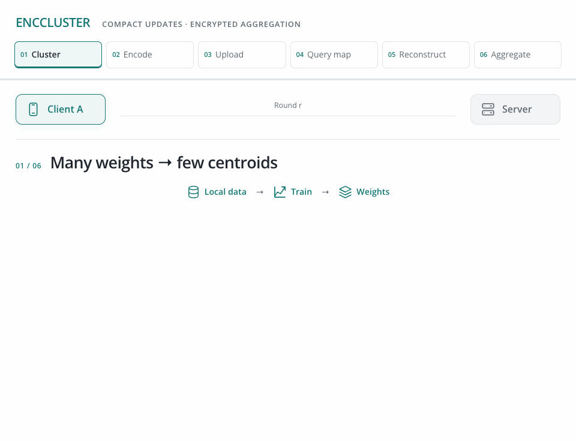

<h1 align="center">EncCluster</h1>
<p align="center"><strong>Scalable Functional Encryption in Federated Learning<br>through Weight Clustering and Probabilistic Filters</strong></p>
<p align="center"><a href="https://vtsouval.github.io/"><strong>Vasileios Tsouvalas</strong></a> · Samaneh Mohammadi · Ali Balador · Tanir Ozcelebi · Francesco Flammini · Nirvana Meratnia</p>

<p align="center">
  <a href="https://doi.org/10.1016/j.pmcj.2025.102021" title="Read the paper"></a>
  <picture></picture>
  <a href="https://nousphera.github.io/projects/enccluster/" title="Explore the project"></a>
  <picture></picture>
  <a href="https://nousphera.github.io/assets/posters/enccluster-a0-landscape.pdf" title="View the poster"></a>
</p>

## Abstract

**EncCluster** combines *weight clustering*, **functional encryption** and *Binary Fuse filters* for federated learning. Clients replace a full update with a compact centroid codebook, encrypt its values and encode where each centroid belongs. The server reconstructs the position mapping and recovers a **sample-weighted aggregate** through client-authorized functional keys. Local data stay on each client; clustering and filter precision control the accuracy–compression trade-off.

<p align="center">
  <a href="https://nousphera.github.io/projects/enccluster/" title="Explore the interactive method">
    <picture>
      <source media="(max-width: 600px) and (prefers-color-scheme: dark)" srcset="docs/assets/readme/method-dark-mobile.gif">
      <source media="(max-width: 600px)" srcset="docs/assets/readme/method-light-mobile.gif">
      <source media="(prefers-color-scheme: dark)" srcset="docs/assets/readme/method-dark.gif">
      
    </picture>
  </a>
</p>

## Setup

Create and activate the `enccluster` environment:

```bash
git clone https://github.com/Nousphera/EncCluster.git
cd EncCluster
python3.11 -m venv --prompt enccluster .venv
source .venv/bin/activate
```

From the activated `enccluster` environment, install the requirements:

```bash
python -m pip install -r requirements.txt
```

## Data and Weights

Download, prepare and validate the datasets:

```bash
# One dataset
python scripts/prepare_data.py --dataset cifar10

# All paper datasets
python scripts/prepare_data.py
```

**Datasets:** `cifar10` · `cifar100`.

**Models:** `resnet20` · `convnext` · `convmixer256_8` · `mobilenet_v2`. All train from scratch; `convnext` uses the paper's compact CIFAR architecture. No model download is needed.

## Run Experiments

From the repository root, choose a method for the Flower simulation:

```bash
common=(--dataset cifar10 --model resnet20 --clients 30 --rounds 100
        --participation 1 --alpha 10 --local-epochs 1 --batch-size 64
        --lr 0.01 --kappa 128 --bpe 8 --precision 3 --device cuda)

# EncCluster (ours)
python scripts/run_experiment.py "${common[@]}" --method enccluster

# Weight clustering + Binary Fuse
python scripts/run_experiment.py "${common[@]}" --method bfuse

# Weight clustering
python scripts/run_experiment.py "${common[@]}" --method cluster

# FedAvg
python scripts/run_experiment.py "${common[@]}" --method fedavg
```

> [!NOTE]
> `--alpha 0.1` selects heterogeneous partitions. For 20% participation, use `--participation 0.2 --rounds 300` (IID) or `--rounds 500` (non-IID). `--seed` controls training; `--partition-seed` keeps client partitions fixed.

Results and final weights are saved under `results/`. `--output` chooses a new run name; `--parallel-clients` controls local concurrency. Use `--device cpu` or `--device mps` for local execution.

### Aggregation

Each simulation round exchanges public keys, encrypted centroids, filters and **mapping-bound authorization shares** in bounded chunks. Floating model state, including BatchNorm statistics, stays encrypted; integer counters use the maximum. Results record ciphertext, mapping and authorization payload sizes separately.

> [!NOTE]
> The protocol assumes authenticated peers and a semi-honest server. Mappings and released aggregates remain observable and can reveal centroid relationships. Authorization traffic is included explicitly; ciphertext compression alone does not establish the paper's total communication ratios.

## Citation

```bibtex
@article{tsouvalas2025enccluster,
  title = {{EncCluster}: Scalable functional encryption in federated learning through weight clustering and probabilistic filters},
  author = {Tsouvalas, Vasileios and Mohammadi, Samaneh and Balador, Ali and Ozcelebi, Tanir and Flammini, Francesco and Meratnia, Nirvana},
  journal = {Pervasive and Mobile Computing},
  volume = {108},
  pages = {102021},
  year = {2025},
  publisher = {Elsevier},
  doi = {10.1016/j.pmcj.2025.102021},
  url = {https://doi.org/10.1016/j.pmcj.2025.102021}
}
```

[License](LICENSE)
