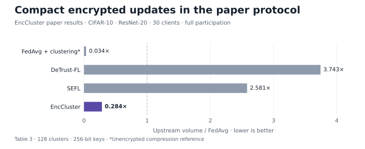

# EncCluster

**EncCluster: Scalable Functional Encryption in Federated Learning through Weight Clustering and Probabilistic Filters**

[ Paper](https://www.sciencedirect.com/science/article/pii/S1574119225000100) · [ Project](https://nousphera.github.io/projects/enccluster/) · [ Code](https://github.com/Nousphera/EncCluster) · [ Preprint](https://arxiv.org/abs/2406.09152) · [ Poster](https://nousphera.github.io/assets/posters/enccluster-a0-landscape.pdf) · [Citation](CITATION.cff)

Vasileios Tsouvalas · Samaneh Mohammadi · Ali Balador · Tanir Ozcelebi · Francesco Flammini · Nirvana Meratnia

Pervasive and Mobile Computing 108, 102021 (2025)

<p align="center">
  <a href="https://nousphera.github.io/projects/enccluster/#findings">
    <picture>
      <source media="(prefers-color-scheme: dark)" srcset="docs/assets/readme/results-dark.svg">
      <source media="(prefers-color-scheme: light)" srcset="docs/assets/readme/results-light.svg">
      
    </picture>
  </a>
</p>

*Paper results: upstream volume on CIFAR-10, ResNet-20; 30 clients, full participation, 128 clusters, 256-bit keys. [Table 3](https://arxiv.org/pdf/2406.09152v1#page=12), using the paper’s encrypted-centroid transport. Explore the [interactive findings](https://nousphera.github.io/projects/enccluster/#findings).*

## Abstract

Federated Learning (FL) enables model training across decentralized devices by communicating solely local model updates to an aggregation server. Although such limited data sharing makes FL more secure than centralized approached, FL remains vulnerable to inference attacks during model update transmissions. Existing secure aggregation approaches rely on differential privacy or cryptographic schemes like Functional Encryption (FE) to safeguard individual client data. However, such strategies can reduce performance or introduce unacceptable computational and communication overheads on clients running on edge devices with limited resources. In this work, we present EncCluster, a novel method that integrates model compression through weight clustering with recent decentralized FE and privacy-enhancing data encoding using probabilistic filters to deliver strong privacy guarantees in FL without affecting model performance or adding unnecessary burdens to clients. We performed a comprehensive evaluation, spanning various datasets and architectures, to demonstrate EncCluster's scalability across encryption levels. Our findings reveal that EncCluster significantly reduces communication costs - below even conventional FedAvg - and accelerates encryption by more than four times over all baselines; at the same time, it maintains high model accuracy and enhanced privacy assurances.

## Installation

Python 3.12 is tested; package metadata permits 3.11–3.13. Use a dedicated virtual environment. Linux needs a C/C++ toolchain, Python development headers, GMP and libffi development libraries (for example, `build-essential python3-dev libgmp-dev libffi-dev` on Debian/Ubuntu). macOS needs Python 3.12 and the standalone Command Line Tools; install GMP/libffi if native cryptographic wheels are unavailable. On Windows, use WSL2 with the Linux prerequisites; native Windows is untested.

```bash
git clone https://github.com/Nousphera/EncCluster.git
cd EncCluster
bash scripts/setup.sh .venv
source .venv/bin/activate
python -m pytest -q
```

The setup script creates the venv, installs `requirements.txt` with the tested `constraints.txt`, and runs `pip check`. On macOS it selects the installed standalone Command Line Tools. Equivalent manual setup:

```bash
python3.12 -m venv .venv
source .venv/bin/activate
# macOS with standalone Command Line Tools:
# export DEVELOPER_DIR=/Library/Developer/CommandLineTools
python -m pip install -c constraints.txt -r requirements.txt
```

Requirements install the vendored PyMIFE source and native cryptographic dependencies, and build the bundled Binary Fuse C bindings. Installation and tests do not download datasets or model weights. See [attribution and licenses](PROVENANCE.md).

## Data

Prepare once, validate, and pass the same parent root to training:

```bash
python scripts/prepare_data.py --dataset cifar10 --root data --download
python scripts/prepare_data.py --dataset cifar10 --root data --validate
```

This fetches the official [CIFAR](https://www.cs.toronto.edu/~kriz/cifar.html) Python data through torchvision's checksum-verified loader, preserving its 50,000/10,000 train/test split. Use `cifar100` for CIFAR-100. Output lives under `data/cifar10/`, including `manifest.json` with file SHA256 hashes, class mapping and split sizes. To import an existing torchvision CIFAR root, use `--source /path/to/extracted-cifar-root` instead of `--download`. Existing prepared roots are never overwritten.

For an explicit image dataset split, use `--dataset imagefolder --source /path/to/splits`, where the source contains `train/CLASS/*` and `test/CLASS/*`. Validation checks class agreement, readable images, exact duplicate image content across splits and file changes. [DATASETS.md](DATASETS.md) gives the complete layout and limits; `python scripts/prepare_data.py --help` lists all options.

## Training

A two-round offline check trains real client models and executes real P-256 functional encryption:

```bash
enccluster-train --output runs/smoke.json
```

Run the prepared CIFAR data through the same primary trainer:

```bash
enccluster-train --dataset cifar10 --data-root data --model tiny \
  --clients 2 --rounds 2 --alpha 10 --precision 1 --output runs/cifar10.json
enccluster-train --help
```

`--method fedavg|cluster|bfuse|enccluster` selects the plaintext baseline and method components. `--bpe 8|16` sets Binary Fuse fingerprint width. Supported image models are `resnet20`, `mlpmixer` and `convnext`; `tiny` provides a compact image model for setup checks. Full-model coordinate FE can be expensive.

The runner simulates clients and aggregation in one process. [Implementation and experiment settings](REPRODUCIBILITY.md) describe the protocol, numerical representation and evaluation metrics.

## Evaluation

The trainer evaluates the prepared test split after each aggregation round. JSON `history` stores `accuracy` as a fraction in `[0, 1]`, mean cross-entropy `loss`, participants and sample counts. Compare `--method fedavg`, `cluster`, `bfuse` and `enccluster` with the same prepared data, seed and training settings.

Inspect the final evaluation from a run above:

```bash
python - <<'PYTHON'
import json
from pathlib import Path
report = json.loads(Path("runs/cifar10.json").read_text())
print(json.dumps(report["history"][-1], indent=2))
PYTHON
```

### Saved outputs

Each named run saves JSON containing configuration, data-manifest hash, exact client partitions, participant/sample counts, metrics and environment versions. A sibling `.pt` stores the final CPU state dictionary and configuration, loadable with `torch.load(..., weights_only=True)`. Existing JSON/checkpoint paths are protected; choose a new output name to rerun. Save the input manifest and run `--validate` before a research experiment; training checks label/split identity, while full file hashing is an explicit preparation check.

## Results

[Table 3 of the paper](https://arxiv.org/pdf/2406.09152v1#page=12) reports the following CIFAR-10 comparison with ResNet-20, 30 clients, full participation, 128 clusters and 256-bit keys. IID and non-IID use Dirichlet concentrations 10 and 0.1. Accuracy changes are percentage points relative to FedAvg; upstream volume is normalized to FedAvg.

| Method | IID accuracy Δ (pp) | Non-IID accuracy Δ (pp) | Upstream / FedAvg ↓ | Client encryption (s) ↓ |
|---|---:|---:|---:|---:|
| FedAvg + weight clustering | −0.12 | −0.71 | 0.034 | — |
| DeTrust-FL | −0.09 | −0.10 | 3.743 | 329.53 |
| SEFL | −0.98 | −1.74 | 2.581 | 7.64 |
| **EncCluster** | **−0.32** | **−0.79** | **0.284** | **2.04** |

The paper's encrypted-centroid protocol sends 28.4% of FedAvg's upstream volume in this setting, with less than one percentage point of accuracy loss. The weight-clustering row is an unencrypted compression reference. These communication and encryption measurements describe the paper's κ-centroid transport; the executable protocol below encrypts each coordinate. See [interactive findings](https://nousphera.github.io/projects/enccluster/#findings) for additional architectures and settings.

## Protocol

The implementation uses decentralized, coordinate-labelled functional encryption on P-256. Clients cluster weights, expand their local vector, and encrypt each coordinate with a unique session/round/position label. Each client sends **d ciphertexts for d model coordinates**; the paper's compressed transport uses κ encrypted centroids. These are different communication and encryption costs. Client secrets stay in client objects; the aggregation object holds public parameters and functional shares. BatchNorm buffers are aggregated in plaintext.

All selected clients must contribute to a round. This local simulator uses in-process message delivery; network authentication, process isolation and dropout recovery require a separate deployment layer. [Protocol details](REPRODUCIBILITY.md) specify fixed-point precision, public bounds and aggregation checks.

## Citation

```bibtex
@article{tsouvalas2025enccluster,
  title = {{EncCluster}: Scalable functional encryption in federated learning through weight clustering and probabilistic filters},
  author = {Tsouvalas, Vasileios and Mohammadi, Samaneh and Balador, Ali and Ozcelebi, Tanir and Flammini, Francesco and Meratnia, Nirvana},
  journal = {Pervasive and Mobile Computing},
  volume = {108},
  pages = {102021},
  year = {2025},
  publisher = {Elsevier},
  doi = {10.1016/j.pmcj.2025.102021},
  url = {https://doi.org/10.1016/j.pmcj.2025.102021}
}
```

## License and attribution

See [LICENSE](LICENSE), [NOTICE](NOTICE), and [PROVENANCE.md](PROVENANCE.md) for the component licenses and source attribution. Third-party code retains its original notices. The pyfilters wrapper and native headers have separate license records in that guide.
